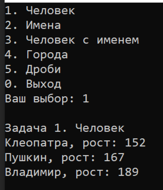

# Бормотова Ксения Группа ИКНТ/О ДВБ7-ЛА3-2025 НБ Лабораторная №3

# Задание 1

## Задача 2

### Текст задачи

Человек.

Создайте сущность Человек, которая описывается:

- Имя: строка
  
- Рост: целое число

Может возвращать текстовое представление вида “Name, рост: height”, где Name и height это переменная с именем и ростом.
Необходимо создать и вывести на экран следующих людей:

- Человек с именем “Клеопатра” и ростом 152
  
- Человек с именем “Пушкин ” и ростом 167
  
- Человек с именем “Владимир ” и ростом 189

### Алгоритм решения

1. Создать класс Person (Человек).
2. Объявить два закрытых свойства:
   - name — для хранения имени человека;
   - height — для хранения роста человека.
4. Создать конструктор, который принимает имя и рост и присваивает их соответствующим свойствам.
5. Создать функцию print(), которая выводит имя и рост человека в формате «Имя, рост: число».
6. В функции main() создать три объекта класса Person:
   
   - “Клеопатра” и ростом 152
  
   -  “Пушкин ” и ростом 167
  
   -  “Владимир ” и ростом 189
8. Вызвать функцию print() для каждого объекта.
9. Завершить выполнение программы.

### Тестирование

## Задача 3

### Текст задачи

Имена.

Создайте сущность Имя, которая описывается тремя параметрами: Фамилия, Личное имя,
Отчество. Имя может быть приведено к строковому виду, включающему традиционное представление всех трех параметров: Фамилия Имя Отчество (например “Иванов Иван Иванович”). Необходимо предусмотреть возможность того, что какой-либо из параметров может быть не задан, и в этом случае он не учитывается при приведении к текстовому виду.

Необходимо создать следующие имена:
- Клеопатра
- Пушкин Александр Сергеевич
- Маяковский Владимир
  
Обратите внимание, что при выводе на экран, не заданные параметры никак не участвуют в
образовании строки.

### Алгоритм решения

1. Создать класс Name (Имя).
2. Объявить три закрытых свойства:
   - surname_ — для хранения фамилии;
   - first_name_ — для хранения личного имени;
   - patronymic_ — для хранения отчества.
3. Создать конструктор, принимающий три параметра.
   Предусмотреть значения по умолчанию в виде пустых строк,
   чтобы любой параметр мог отсутствовать.
4. Создать функцию GetFullName(), которая формирует полное имя:
   - проверить, задана ли фамилия;
   - проверить, задано ли личное имя;
   - проверить, задано ли отчество;
   - добавить только непустые параметры, разделяя их пробелами.
5. Создать функцию print(), которая выводит сформированное имя
   на экран.
6. В функции main() создать три объекта класса Name:
   - Клеопатра;
   - Пушкин Александр Сергеевич;
   - Маяковский Владимир.
7. Вызвать функцию print() для каждого объекта.
8. Завершить выполнение программы.

### Тестирование

# Задание 2

## Задача 2

### Текст задачи

Человек с именем.

Объедините сущности Человек из задачи 1.2 и Имя из задачи 1.3 таким образом, чтобы имя человека задавалось с использованием сущности 1.3, а не строки.

Необходимо объединить ранее созданные объекты имен и людей, с получением:
- Человека с Именем Клеопатра и ростом 152
- Человека с Именем Пушкин Александр Сергеевичи ростом 167
- Человека с Именем Маяковский Владимир и ростом 189

### Алгоритм решения

1. Создать класс PersonWithName (Человек с именем).
2. Объявить два закрытых свойства:
   - name_ — для хранения объекта класса Name;
   - height_ — для хранения роста человека.
3. Создать конструктор, который принимает объект класса Name
   и рост человека.
4. Создать функцию print(), которая выводит полное имя человека
   и его рост.
5. В функции RunPersonWithNameTask() создать три объекта
   класса Name:
   - Клеопатра;
   - Пушкин Александр Сергеевич;
   - Маяковский Владимир.
6. Создать три объекта класса PersonWithName, передав им
   соответствующие объекты Name и рост:
   - Клеопатра — 152;
   - Пушкин Александр Сергеевич — 167;
   - Маяковский Владимир — 189.
7. Вызвать функцию print() для каждого объекта.
8. Добавить третью задачу в меню главной функции main().
9. Завершить выполнение программы.

### Тестирование

# Задание 3

## Задача 3

### Текст задачи

Города.

Создайте сущность Город, которая будет представлять собой точку на карте со следующими характеристиками:
- Название города
- Набор путей к следующим городам, где путь представляет собой сочетание Города и
стоимости поездки в него.

Кроме того, Город может возвращать текстовое представление, в виде названия города и списка
связанных с ним городов (в виде пары: “название:стоимость”).

Используя разработанную сущность реализуйте схему, представленную на рисунке 2.

Рис.2

### Алгоритм решения

1. Создать класс City (Город).
2. Объявить закрытое свойство name_ для хранения названия города.
3. Создать структуру Path, содержащую:
   - указатель на связанный город;
   - стоимость поездки.
4. Объявить свойство paths_ типа vector для хранения списка путей.
5. Создать конструктор, принимающий название города.
6. Создать функцию AddPath(), которая добавляет в список
   новый путь, связанный с другим городом, и его стоимость.
7. Создать функцию print(), которая выводит название города
   и список связанных городов с указанием стоимости поездки.
8. В функции RunCityTask() создать шесть объектов класса City:
   A, B, C, D, E, F.
9. С помощью функции AddPath() добавить пути между городами
   в соответствии с направлениями стрелок и стоимостью,
   указанными на рисунке.
10. Вызвать функцию print() для каждого города.
11. Добавить четвертую задачу в меню функции main().
12. Завершить выполнение программы.

### Тестирование

# Задание 4

## Задача 8

### Текст задачи

Создаем Города.

Измените сущность Город из задачи 3.3. 

Новые требования включают:
- Город можно создать указав только название
- Город можно создать указав название и набор связанных с ним городов и стоимостей
путей к ним

### Алгоритм решения

1. Подключить библиотеку utility для использования std::pair.
2. В классе City оставить существующие свойства:
   - name_ — название города;
   - paths_ — список путей к другим городам.
3. Оставить существующий конструктор, принимающий только название.
4. Добавить перегруженный конструктор, принимающий название
   города и список связанных городов с их стоимостью.
5. В новом конструкторе сохранить название города.
6. С помощью цикла перебрать переданный список путей
   и добавить каждый путь в свойство paths_.
7. Оставить функцию AddPath() для добавления новых путей
   после создания города.
8. Оставить функцию print() для вывода названия города
   и списка связанных с ним городов.

### Тестирование

# Задание 5

## Задача 5

### Текст задачи

Дроби.

Создайте сущность Дробь со следующими особенностями:
- Имеет числитель: целое число
- Имеет знаменатель: целое число
- Дробь может быть создана с указанием числителя и знаменателя
- Может вернуть строковое представление вида “числитель/знаменатель”
- Может выполнять операции сложения, вычитания, умножения и деления с другой Дробью или целым числом. Результатом операции должна быть новая Дробь (таким образом,обе исходные дроби не изменяются)
  
Затем необходимо выполнить следующие задачи:
1. Создать несколько экземпляров дробей.
2. Написать по одному примеру использования каждого метода.
3. Вывести на экран примеры и результаты их выполнения в формате «1/3 * 2/3 = 2/9»
4. Посчитать f1.sum(f2).div(f3).minus(5)

### Алгоритм решения

1. Создать класс Fraction (Дробь).
2. Объявить два закрытых свойства:
   - numerator_ — числитель;
   - denominator_ — знаменатель.
3. Создать конструктор, принимающий числитель и знаменатель.
   Предусмотреть проверку, чтобы знаменатель не был равен нулю.
4. Создать функцию ToString(), которая возвращает строковое
   представление дроби в формате «числитель/знаменатель».
5. Создать функцию sum() для сложения дробей и целых чисел.
6. Создать функцию minus() для вычитания дробей и целых чисел.
7. Создать функцию multiply() для умножения дробей
   и целых чисел.
8. Создать функцию div() для деления дробей и целых чисел.
   Предусмотреть проверку деления на ноль.
9. Все арифметические функции должны возвращать новые объекты
   класса Fraction, не изменяя исходные дроби.
10. Создать функцию print() для вывода дроби на экран.
11. В функции RunFractionTask() создать три объекта Fraction.
12. Продемонстрировать сложение, вычитание, умножение
    и деление дробей и целых чисел.
13. Вычислить выражение f1.sum(f2).div(f3).minus(5).
14. Вывести примеры операций и их результаты на экран.
15. Добавить пятую задачу в меню функции main().
16. Завершить выполнение программы.

### Тестирование
